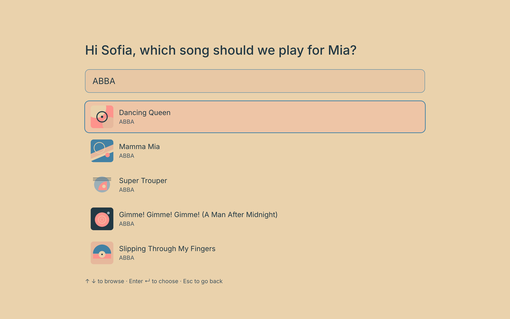
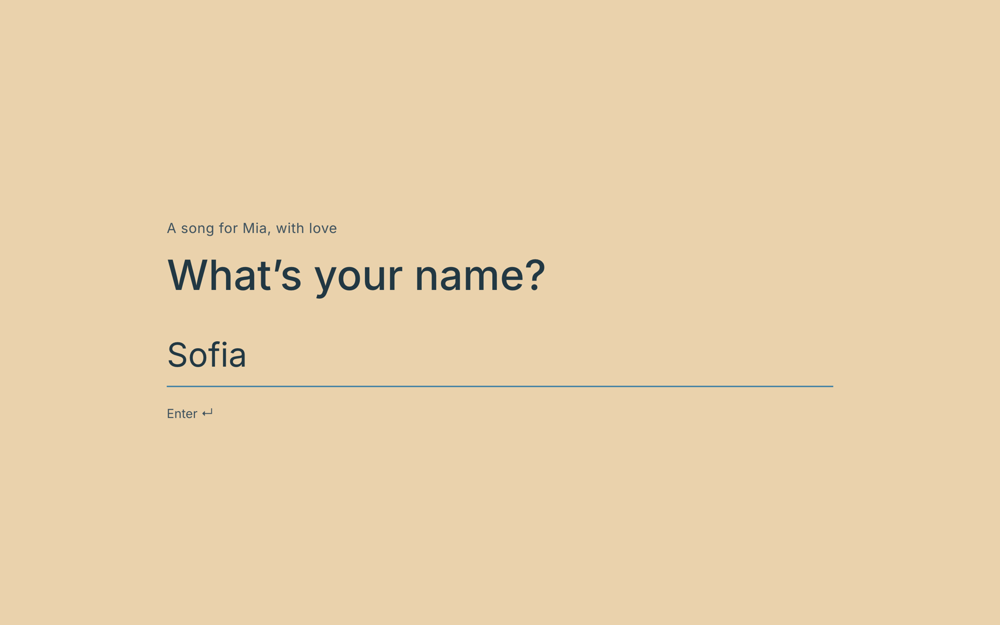
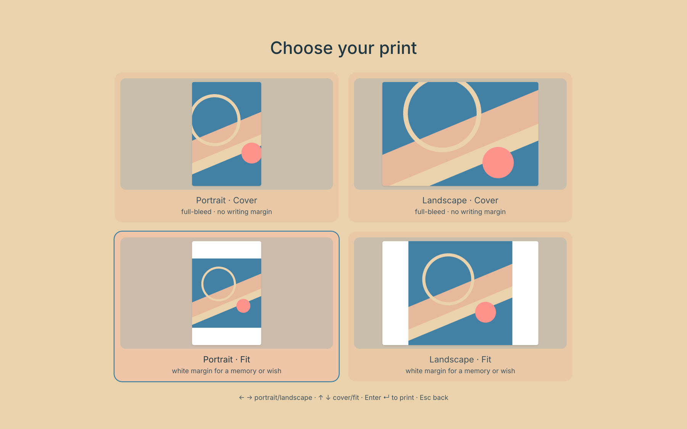

# Soundtrack Kiosk

**A party playlist your guests can hold.**

[](https://github.com/filo87/Soundtrack-Kiosk/actions/workflows/ci.yml)
[](https://github.com/filo87/Soundtrack-Kiosk/releases/latest)


<p align="center">
  
</p>

Soundtrack Kiosk turns a shared Spotify playlist into a physical keepsake. Guests walk up, type
their name, search for a song, and choose how the album art prints. They leave with a 10 x 15 cm
print for the album, with room to write a memory or a wish.

Built for baby showers, first birthdays, naming days, and the people who gather around them. One
kiosk, one shared playlist, one print per guest.

[Download for macOS](https://github.com/filo87/Soundtrack-Kiosk/releases/latest) ·
[How it works](#how-it-works) ·
[Run it locally](#quick-start)

## Why it works

- **No phones, no accounts.** Guests spend a few seconds at the kiosk: name, song, print.
- **A playlist and a print.** Every new pick joins the shared Spotify playlist; every guest still
  leaves with album art.
- **Made for handwriting.** **Fit** leaves a white margin for a memory or wish; **Cover** is
  full-bleed album art.
- **Resilient by design.** If Spotify drops, manual entry keeps the line moving and playlist adds
  drain when the connection returns.
- **Kind to staff.** One admin overlay covers Spotify, the printer, event copy, the PIN,
  maintenance, and history.
- **Local-first.** Settings, tokens, journals, and print files stay on the kiosk.

## Screenshots

| Welcome                                                           | Choose a print                                                         |
| ----------------------------------------------------------------- | ---------------------------------------------------------------------- |
|  |  |

_Screenshots use demo data._

## How it works

1. **Say hello.** The guest enters their name and sees a welcome line written for the event.
2. **Pick the song.** Search Spotify, or use manual title/artist entry when Spotify is unavailable.
   The pick is added to the shared playlist.
3. **Choose the print.** Pick portrait or landscape, then **Cover** for full-bleed art or **Fit**
   for a white writing margin.
4. **Make it personal.** The print drops at the printer. The guest sticks it into the album and
   writes a memory or wish beside it.

The memory itself stays handwritten. Soundtrack Kiosk prints the art; the words stay with the
guest.

## Download

The latest release ships DMG and app zip builds for both architectures:

- **Apple Silicon** — `Soundtrack-Kiosk-<version>-macos-arm64.dmg`
- **Intel** — `Soundtrack-Kiosk-<version>-macos-x86_64.dmg`

[Open the latest release](https://github.com/filo87/Soundtrack-Kiosk/releases/latest), download the
matching DMG, drag **Soundtrack Kiosk** to Applications, and launch it. Requires macOS 11 or newer.

The builds are unsigned and not notarized. If macOS blocks the first launch, use **System Settings
→ Privacy & Security → Open Anyway**, or run:

```bash
xattr -dr com.apple.quarantine "/Applications/Soundtrack Kiosk.app"
```

## Requirements

- macOS 11 or newer (the app is macOS-only).
- Node.js 20+ and pnpm 12 (`packageManager` is pinned in `package.json`).
- rustup with the toolchain pinned in `rust-toolchain.toml` (`1.100.0`), including `rustfmt` and `clippy`.
- Xcode Command Line Tools: `xcode-select --install`.
- CUPS tools (`lp`, `lpstat`) for real printing.
- A Spotify developer app:
  - The app owner needs Spotify Premium (Spotify Development Mode requirement).
  - Development Mode allows at most 5 allowlisted users.
  - Redirect URI must be exactly `http://127.0.0.1:43821/callback`.
  - Requested scopes: `playlist-modify-public playlist-modify-private playlist-read-private`.

## Quick start

```bash
pnpm install --frozen-lockfile
pnpm tauri dev
```

The first Rust build takes several minutes. The window is a real kiosk window: borderless, always on top, and fullscreen.

- Exit: `Ctrl + Option + Shift + K`, PIN `0000`, then **Exit kiosk** (or force-quit).
- Debug builds use the **Mock printer** and copy simulated prints to `mock-prints/`.
- To exercise CUPS in development: `BABY_KIOSK_PRINTER=cups pnpm tauri dev`.
- `pnpm dev` alone only serves the React UI in a browser; Tauri IPC calls will fail. Use it for layout work only.

Production bundle:

```bash
pnpm tauri build
open "src-tauri/target/release/bundle/macos/Soundtrack Kiosk.app"
```

Debug bundle:

```bash
pnpm tauri build --debug --bundles app
open "src-tauri/target/debug/bundle/macos/Soundtrack Kiosk.app"
```

## Tech stack

- **Desktop shell:** Tauri v2 with a hardened fullscreen kiosk window: borderless, always on top,
  Dock/menu bar hidden, process switching disabled, and close/minimize guards.
- **Backend:** Rust for Spotify PKCE and token refresh, iTunes artwork matching, four render
  variants, an append-only journal, the playlist outbox, CUPS printing, and health.
- **Frontend:** React 18, TypeScript, Vite, Tailwind CSS v4, and Framer Motion.
- **Music:** Spotify Web API with iTunes Search API for high-resolution art.
- **Printing:** CUPS with a Canon SELPHY CP1500; a Mock backend for development.
- **Storage:** local JSON settings, `0600` tokens, fsynced `journal.jsonl`, and a local cover/print
  cache.

The webview only talks to Rust through typed Tauri commands. Spotify tokens and all HTTP requests
stay in the Rust process.

## Palette

The UI uses these five colors consistently:

| Color        | Hex       | Use                                   |
| ------------ | --------- | ------------------------------------- |
| Sweet Salmon | `#FE938C` | selection, attention dot, accents     |
| Desert Sand  | `#E6B89C` | surfaces and input fields             |
| Wheat        | `#EAD2AC` | page background                       |
| Cool Steel   | `#9CAFB7` | borders and preview wells             |
| Cerulean     | `#4281A4` | selection rings, focus borders, links |

Body text uses a dark blue ink (`#223843`) and muted secondary text (`#40535E`) for contrast.

## CI and releases

`.github/workflows/ci.yml` runs `pnpm verify` on pushes to `master` and on pull requests.
`.github/workflows/release.yml` calls the same verification job, then builds and publishes both
architectures.

Tag a release with a semver tag starting with `v`:

```bash
git tag v0.1.0
git push origin v0.1.0
```

For the tag, the release workflow:

1. Runs the full `pnpm verify` gate.
2. Builds `aarch64-apple-darwin` (Apple Silicon) and `x86_64-apple-darwin` (Intel).
3. Sets the bundle version from the tag.
4. Publishes a GitHub Release with DMG and app zip assets for each architecture, plus
   `SHA256SUMS`.

Asset names use the tag without the `v`, for example
`Soundtrack-Kiosk-0.1.0-macos-arm64.dmg`. The builds are unsigned and not notarized; the release
notes include the first-launch workaround. Use the arm64 build on Apple Silicon and the x86_64
build on Intel.

## Spotify setup

1. In the Spotify Developer Dashboard, create an app and add the redirect URI above.
2. Start the kiosk, open admin (`Ctrl + Option + Shift + K`), and set the **Spotify client id**, then **Save**.
3. Click **Login / relogin**. The browser opens; the kiosk temporarily leaves kiosk mode for the login.
4. Under **Playlist**, pick one of your playlists or create a new one by name, then **Save**. The playlist owner must match the logged-in account. The owner check runs when settings are saved.

Without a valid login, search returns no results and the guest flow falls back to manual song/artist entry. Those selections are journaled, printed, and added to the playlist once login returns.

## Admin

Open with `Ctrl + Option + Shift + K`.

The overlay is split into six sections:

- **Overview** — what needs attention, paper/ink progress, refill actions, and a test print.
- **Spotify** — connection, client id, choose one of your playlists or create a new one, market and iTunes country.
- **Printer** — backend badge, queue selection, default orientation, status/reason, and a test print.
- **Event** — baby name and welcome line with a live Name-screen preview.
- **Security** — change PIN, maintenance mode, and the kiosk exit danger zone.
- **History** — searchable recent selections, per-row reprint, CSV export, and local history clear.

Fresh install PIN: `0000`. The kiosk shows a salmon staff dot and refuses to save settings until a
different 4-12 digit PIN is set.

- Unsaved edits show a sticky **Unsaved changes** bar. **Save** sends the whole settings form;
  **Discard** restores the last saved values. Paper and ink counters are server-owned and update
  automatically. `Cmd/Ctrl+S` saves.
- The **Spotify** section shows the redirect URI with a **Copy** button. It must match the Spotify
  app character for character; the callback port is fixed at 43821.
- Admin sessions expire after 5 minutes idle; Esc closes the overlay. Closing with unsaved edits
  asks for confirmation.
- **Clear local history** (History section) requires typing `CLEAR`. It archives the journal to
  `journal-YYYYMMDD-HHMMSS-mmm.jsonl`, empties the local list, clears local duplicate memory, and
  drops pending playlist adds (archived, not sent). The Spotify playlist is not changed. Print
  files are kept.
- **Reset both** zeroes the paper and ink counters. **Paper refilled** and **Ink replaced** reset
  one counter at a time.
- **Export CSV** (History section) writes `~/Desktop/soundtrack-YYYYMMDD-HHMMSS.csv`.
- **Maintenance mode** (Security section) temporarily leaves kiosk mode for browser or diagnostics
  work.

## Printing

The printer is a Canon SELPHY CP1500 over USB through CUPS.

- Debug/default backend: `Mock` (no hardware needed).
- Release/default backend: `Cups`.
- Override either with `BABY_KIOSK_PRINTER=mock` or `BABY_KIOSK_PRINTER=cups`.
- The app submits portrait/landscape PNGs with `lp`, `media=Postcard`, `print-scaling=fill`, and `orientation-requested=3|4`.
- Cover art resolves from iTunes 3000x3000 (strict artist/title match) -> Spotify 640 -> bundled placeholder.
- Duplicate protection uses normalized title + artist: the second guest still gets a print, but the playlist add is skipped.
- Media and borderless options must be confirmed on the event unit. Record the frozen values in `docs/printer-notes.md`.

## Data

App data directory:

```text
~/Library/Application Support/com.soundtrack.kiosk/
  settings.json             # 0600; includes the plaintext admin PIN
  tokens.json               # 0600; Spotify access/refresh tokens
  journal.jsonl             # append-only selection/print/playlist history
  covers/                   # cover cache, one directory per album/manual key
  previews/                 # transient four-layout previews, purged on startup
  prints/YYYY-MM-DD/        # durable print files referenced by the journal
  mock-prints/              # Mock backend output
  journal-*.jsonl           # archives created by Clear local history
```

Logs are written by `tauri-plugin-log` under:

```text
~/Library/Logs/com.soundtrack.kiosk/
```

`journal.jsonl` is the source of truth. Deleting or truncating it manually is not supported; use the admin action so the file is archived and the in-memory projection is reset.

## Upgrading from Baby Playlist Kiosk

The previous build used the bundle identifier `com.soundtrack.babykiosk`. Soundtrack Kiosk uses
`com.soundtrack.kiosk`.

On first launch, if the new data directory has no settings/tokens/journal, the app copies the old
data directory (settings, tokens, journal, covers, prints) into the new one. The old directory is
left untouched as a backup.

To replace an installed build:

1. Quit the old app.
2. Replace `/Applications/Baby Playlist Kiosk.app` with `Soundtrack Kiosk.app`.
3. Launch Soundtrack Kiosk once and confirm settings, login, and history.
4. Remove the old app and the old data directory when satisfied.
5. Reinstall the LaunchAgent from `src-tauri/launchd/com.soundtrack.kiosk.plist`; unload the old
   `com.soundtrack.babykiosk` label first.

Old logs remain under `~/Library/Logs/com.soundtrack.babykiosk/`.

## Scripts

| Command            | Purpose                                                     |
| ------------------ | ----------------------------------------------------------- |
| `pnpm dev`         | Vite only (no Tauri IPC).                                   |
| `pnpm build`       | Typecheck + production frontend build.                      |
| `pnpm tauri dev`   | Full app in development (Mock printer by default).          |
| `pnpm tauri build` | Release `.app`/`.dmg` (CUPS by default).                    |
| `pnpm test`        | Vitest run.                                                 |
| `pnpm test:watch`  | Vitest watch mode.                                          |
| `pnpm typecheck`   | `tsc --noEmit`.                                             |
| `pnpm lint`        | ESLint.                                                     |
| `pnpm rust:test`   | `cargo test`.                                               |
| `pnpm rust:clippy` | `cargo clippy --all-targets -- -D warnings`.                |
| `pnpm verify`      | Typecheck, lint, Vitest, rustfmt check, clippy, Rust tests. |

`pnpm verify` needs cargo on PATH. If `cargo` is not found, add the rustup shim:

```bash
export PATH="$HOME/.cargo/bin:$PATH"
```

## Testing

```bash
pnpm verify
```

Current coverage:

- Vitest: reducer transitions, idle timers, stale search responses, full guest cycle and manual fallback, four-layout commit, command ACL coverage.
- Rust: PKCE vector, token rotation/refresh/concurrency, callback parsing, journal projection/recovery/clear, cover matching and iTunes URL rewrite, four render variants, CUPS parsers, duplicate identity.

Hardware/manual gates that cannot be automated here:

- Real Spotify login and playlist insert.
- CP1500 paper/orientation/borderless matrix and printer error drills.
- LaunchAgent/auto-login installation.
- Offline drill: Wi-Fi off -> manual entry -> print -> Wi-Fi on -> outbox drains.

## Architecture

```text
src/ (React)
  App.tsx, main.tsx
  kiosk/machine.ts          pure reducer
  kiosk/useKiosk.ts         effects: search debounce, prepare, commit, idle
  kiosk/screens/            Name, Search, Choose (4 layouts), Done
  admin/                    shell, useAdmin, validation, ui, sections/*, PIN pad
  lib/ipc.ts                typed invoke wrappers and KioskError
  lib/types.ts              hand-written DTOs mirroring Rust

src-tauri/src/ (Rust)
  lib.rs                    builder, plugins, handlers, window/run guards
  commands.rs               Tauri commands and orchestration
  spotify/                  PKCE auth, token manager, Web API wrapper
  cover/                    iTunes matching + Spotify/placeholder fallback
  render.rs                 four preview variants (cover/fit)
  journal.rs                append-only history + projections
  outbox.rs                 playlist insert retry loop
  print.rs                  CUPS/Mock submission and status
  health.rs                 health event + staff dot data
  kiosk/                    macOS window/presentation options
  state.rs, config.rs, paths.rs, admin.rs, error.rs
```

The webview only talks to Rust through typed Tauri commands. Spotify tokens and all HTTP requests stay in Rust.

## Documentation

- `.kilo/plans/1795620449114-baby-playlist-kiosk-plan.md` - decisions, contracts, milestones, failure modes.
- `docs/runbook.md` - one-page staff runbook.
- `docs/printer-notes.md` - CUPS/SELPHY options and hardware test matrix.
- `AGENTS.md` - repository conventions and change recipes for coding agents.

## Known limitations

- macOS only.
- Physical keyboard required; no on-screen keyboard.
- `Fit` is the writing-friendly layout: it adds a white margin around the full cover. `Cover` is
  full-bleed and leaves no space for a handwritten note.
- The handwritten memory/wish is not captured by the app.
- Duplicate protection is local. Clearing local history resets it, so a song already in the playlist can be added again afterwards.
- Print media/borderless options are provisional until verified on the event printer.
